# ListFlick

Mobile-first app that turns item photos into polished resale listing drafts
for online marketplaces. The workflow is:

```text
photos → upload and quality checks → AI analysis → review/edit → save → optional Notion sync
```

## Documentation

The canonical developer documentation is indexed in
[`docs/README.md`](docs/README.md). It contains:

- tutorials for local development, mobile builds, and the first listing;
- how-to guides for setup, tunnels, Firebase, Supabase, testing, deployment,
  troubleshooting, and Git;
- reference pages for architecture, environments, Makefile commands,
  configuration, APIs, authentication, storage, EAS, and logging;
- explanations of the Firebase/Supabase boundary, image flow, storage
  lifecycle, deployment environments, and Notion modes.

Use this README for orientation. Use `docs/` for operational instructions.
Product specifications and marketplace context remain under `docs/` but are
clearly separated from current implementation reference.

## User flow

This diagram summarizes the implemented path from sign-in and explicit AI
provider setup through listing creation, review, and saved-listing actions.
New users choose Gemini or Groq before ListFlick requests that provider's API
key; ListFlick does not assume a default provider.



See the canonical [Mermaid source](docs/user-flow.mmd). Regenerate the SVG with
`make docs-user-flow`.

## Project structure

```text
marketplace-listing-assistant/
├── backend/          # FastAPI API, AI providers, database, and storage boundary
├── mobile/            # Expo React Native application and native Firebase client
├── docs/              # Diátaxis documentation source of truth
├── scripts/           # Backend/mobile startup and API smoke scripts
├── Makefile           # Repository development and build commands
├── render.yaml        # Render backend service configuration
└── AGENTS.md          # Repository automation and Graphify instructions
```

## Quick start

Install dependencies:

```bash
make install-backend
make install-mobile
```

Configure `backend/.env` from `backend/.env.example` and `mobile/.env` from
`mobile/.env.example`. Start two terminals:

```bash
make backend
make mobile
```

The mobile app uses native Firebase packages, so use an Expo Development Build
(`npx expo run:ios` or `npx expo run:android`), not Expo Go. `mobile/ios` and
`mobile/android` are generated, not committed: copy your Firebase files into
`mobile/config/` first, and `npx expo run:ios` runs prebuild when the folders
are missing. After changing `app.json`, `app.config.js` or `mobile/plugins/`,
run `npx expo prebuild --clean`. Sign in before
using protected item and image routes.

Run validation with:

```bash
make test
cd mobile && npm test
make smoke
```

ListFlick also includes six local Maestro flows for authentication and
onboarding, provider configuration, listing creation, explicit AI-assisted
field improvement, photo management, and server-backed image download. They
use an isolated deterministic backend and do not call Gemini or Groq. See the
[local Maestro UI guide](docs/how-to/maestro-create-listing.md).

See [Local development](docs/tutorials/local-development.md) for the complete
setup and [Makefile commands](docs/reference/makefile-commands.md) for the
repository command reference.

## Current architecture

- Firebase Authentication provides user identity.
- FastAPI verifies Firebase ID tokens and scopes item operations to the UID.
- PostgreSQL stores item records, idempotency claims, listing state, and
  resumable analysis leases.
- Gemini or Groq provides request-inline analysis and listing generation.
- Private Supabase Storage stores deployed images; local development can use
  the `backend/uploads/` fallback.
- Render hosts the backend deployment.
- EAS builds the mobile development, preview, and production clients.
- Notion synchronization is optional and deployment-configured.

See [System architecture](docs/reference/architecture.md) and
[Runtime and environments](docs/reference/runtime-and-environments.md).

## AI provider keys

BYOK is recommended for public deployments. When server-key fallback is off,
new users begin with no selected provider and must choose Gemini or Groq before
using AI. They then manage only that provider's key from the focused API-key
row. Keys stay in device secure storage, travel only on requests that execute
that provider, and are not persisted by ListFlick. Settings labels a nonblank
key as **Saved on this device**, not configured or valid: the provider validates
it on the next AI request, and a rejection opens the replacement-key flow.

Self-hosters may instead configure `GEMINI_API_KEY` and/or `GROQ_API_KEY` and
explicitly set `ALLOW_SERVER_AI_KEY_FALLBACK=true`. This makes the deployment
owner responsible for provider usage and cost. In this mode, a user without a
saved preference uses the deployment's `AI_PROVIDER`; **AI Provider — Choose**
in Settings means no user override is saved. A saved preference overrides that
default. The current request-inline analysis model keeps device credentials
request-scoped; a future autonomous worker will require a separate
credential-delegation/storage design.

The tracked Render blueprint keeps server fallback disabled. It contains no
provider key values, backend URL, Firebase project ID, Supabase project ID, or
EAS project ID belonging to the repository owner. A clone therefore cannot use
the owner's AI credits or hosted infrastructure by default. Self-hosters must
configure their own backend, Firebase project, storage/database, mobile API
URL, and optional EAS project before building a usable app.

## Important configuration note

The backend uses PostgreSQL through `asyncpg`. Database schema changes are
applied through the versioned startup migrations in
`backend/app/db/migrations.py`. See the
[environment reference](docs/reference/environment-variables.md) for the
required connection string.

## Product status

Implemented capabilities include image upload and quality checks, multi-image
listing generation, Gemini/Groq provider selection, AI Insights, listing
editing, image management, local inventory, Firebase Authentication, private
Supabase Storage, optional Notion synchronization, profile defaults, sharing,
reconnect-driven upload/analysis recovery, and Render/EAS deployment paths.

The current Render configuration has no background worker. If a web process
stops mid-analysis, the mobile app resumes the durable job after reconnecting;
autonomous disconnected processing is a planned future improvement.

Facebook auto-posting is intentionally excluded. The app prepares copy-ready
listing content and opens native sharing flows instead.

For current AI Insights intent and product specification, see the retained
product document [`AI_INSIGHTS_PRODUCT_SPEC.md`](docs/AI_INSIGHTS_PRODUCT_SPEC.md).

## License

MIT — see [LICENSE](LICENSE).

## Legal and support

The beta privacy policy, terms of use, support channel, and account-deletion
process are documented in [`docs/legal/README.md`](docs/legal/README.md).
Privacy and Terms are bundled for offline reading in Settings, and Contact
Support opens a user-editable email with a copy fallback. Signed-in users can
delete their account from **Settings → Delete Account**.
